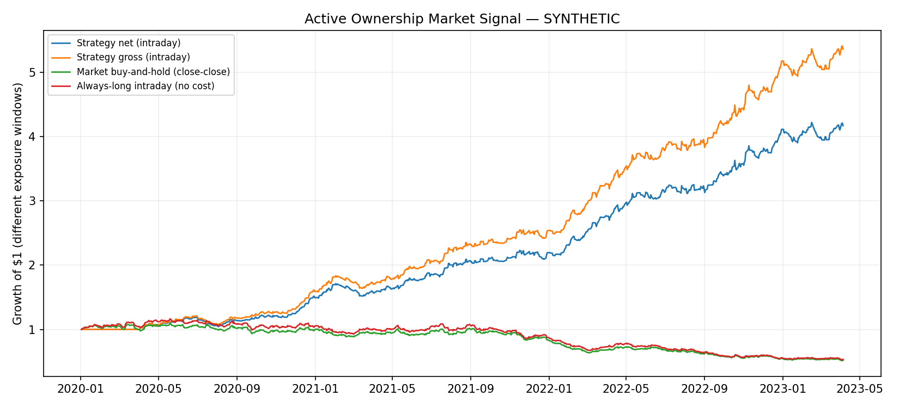

# Backtest Results — SYNTHETIC

**EVIDENCE STATUS: SYNTHETIC TEST ONLY — NOT EMPIRICAL ALPHA**

This is an **inspired-by** implementation of Chen & Yin (2026), not an exact replication.
No paper result (including Sharpe ≈ 1) is claimed to have been reproduced.

## Prespecified signal and execution
- Ownership: most recently **published** active-ownership snapshot; same-day publications excluded.
- Signal: end-of-day high-minus-low daily stock return spread.
- Signal normalization: 126-day trailing z-score, past days only.
- Entry/exit: **next open → same-day close**, not an unattainable close-to-close fill.
- Trading costs: 2.0 basis points per side; one daily round trip when active.
- Strategy: long (+1), short (-1), or flat; unit notional; no leverage.

## Results
| Metric | Result |
| --- | ---: |
| Valid signal days | 850 |
| Trading days | 850 |
| Active fraction | 0.7400 |
| Net cumulative return | 3.1699 |
| Net CAGR | 0.5270 |
| Net annualized Sharpe | 2.8902 |
| Net max drawdown | -0.1232 |
| Last 30% net Sharpe | 2.4037 |
| Predictive beta (next-day close-close) | 0.3428 |
| Predictive HAC t-stat / p-value | 7.1924 / 0.0000 |
| Block-bootstrap Sharpe CI (95%) | [1.8900254553494877, 4.018014689020044] |

## Critical limitations
1. The authors' complete paper specification was not available for verification, so quintile definitions, adjustments, and universes may differ.
2. 13F holdings are delayed, long-only and incompletely reveal economic exposure; historical fund classification is essential.
3. Backtest quality depends on survivor-free, delisting-inclusive daily returns, security IDs and CUSIP crosswalks.
4. Predictive close-close returns are **not** credited as executable P&L; intraday P&L excludes the following overnight return.
5. This backtest does not estimate the paper's rational-expectations model or reproduce its structural 20% share.
6. For genuine out-of-sample evaluation, freeze thresholds on a training period before reviewing test results.
